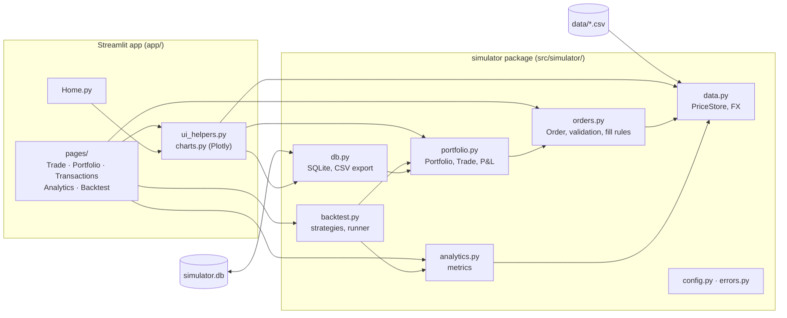

# Stock Trading Simulator

[](https://github.com/soban0928/portfolio-tracker./actions/workflows/ci.yml)


A virtual stock trading simulator built with Python, pandas, Streamlit and SQLite.
You start with **£10,000**, trade US and UK stocks at historical prices, and see
your performance, risk and fees just as a real brokerage account would show them.
Fills are realistic: market, limit and stop orders are matched against the daily
bar. Every trade pays commission and slippage. US trades convert to GBP at that
day's exchange rate. A backtesting module runs rule-based strategies through the
same engine.

## Contents

- [Features](#features)
- [Screenshots](#screenshots)
- [Quick start](#quick-start)
- [Market data](#market-data)
- [Architecture](#architecture)
- [Design decisions](#design-decisions)
- [Limitations](#limitations)
- [Testing and CI](#testing-and-ci)
- [Deploying to Streamlit Community Cloud](#deploying-to-streamlit-community-cloud)

## Features

| Area | What it does |
|---|---|
| **Virtual trading** | £10,000 starting cash (configurable). Buy and sell at historical prices. Orders are validated for insufficient cash, insufficient shares, invalid quantity and missing price data. Short selling isn't allowed. |
| **Realistic execution** | A configurable flat commission (default £5) and slippage/spread in basis points (default 10 bps) apply to every fill. |
| **Order types** | Market (fills at the open), limit and stop-loss, matched against the daily open/high/low and aware of price gaps. Unfilled orders stay pending until they trigger or you cancel them. |
| **Portfolio engine** | Cash, holdings, weighted-average cost basis, realised and unrealised P&L, total return and fees paid. |
| **Multi-currency** | US stocks are priced in USD and converted to GBP with historical GBP/USD rates. London (`.L`) listings trade in GBP. |
| **Analytics** | Total and annualised return, annualised volatility, Sharpe ratio, max drawdown, and beta and alpha against the S&P 500 (SPY), with a benchmark comparison chart. |
| **Backtesting** | Buy-and-hold, moving-average crossover and momentum strategies over any date range. Results are compared with the benchmark, and the same fees apply to both. |
| **Persistence** | Portfolios, trades and orders are saved in SQLite and survive restarts. Trade history can be exported to CSV. |
| **Dashboard** | Streamlit pages for Trade, Portfolio, Transactions, Analytics and Backtest. Every chart uses Plotly. |

## Screenshots

> _Placeholders: add screenshots to `docs/screenshots/` and update the links._

| Trade | Portfolio |
|---|---|
|  |  |
| **Analytics** | **Backtest** |
|  |  |

## Quick start

Requires Python 3.11 or later.

```bash
git clone https://github.com/soban0928/portfolio-tracker..git
cd portfolio-tracker.

python -m venv .venv
source .venv/bin/activate            # Windows: .venv\Scripts\activate
pip install -e ".[dev]"              # app + test/lint tooling

streamlit run app/Home.py            # opens http://localhost:8501
```

The app works offline straight away using the bundled sample data. State is
saved to `simulator.db` in the project root. Set `SIMULATOR_DB=/path/to/file.db`
to use a different database.

**A typical session:**

1. Go to **Trade**, pick a date, a ticker and an order type, and place an order.
2. Use **Advance simulation** to move the portfolio's date forward. Pending limit
   and stop orders are checked on each trading day along the way.
3. Review the **Portfolio**, **Transactions** and **Analytics** pages, then try
   strategies on **Backtest**.

## Market data

| Folder | Contents |
|---|---|
| `data/sample/` | Bundled **synthetic** prices (2019–2024) for AAPL, MSFT, GOOGL, AMZN, NVDA, SPY, VOD.L and GBPUSD. Committed so the app and tests run offline. |
| `data/downloaded/` | Real prices from Yahoo Finance (git-ignored). Takes precedence over the samples. |

> **The bundled samples are synthetic, not real market data.** Yahoo Finance
> wasn't reachable from the environment this project was built in, so
> `scripts/generate_sample_data.py` produces them with a seeded one-factor model
> (each stock = beta × market + noise). Prices are realistic-looking but fictional.
> The sidebar shows a notice whenever the app is running on synthetic data.

To fetch real data:

```bash
pip install yfinance
python scripts/download_data.py                                 # default tickers, 2019–2024
python scripts/download_data.py --tickers AAPL TSLA BP.L --start 2015-01-01
```

The CSV format is `Date,Open,High,Low,Close,Volume`, one file per ticker. You can
drop in any CSV with these columns. `GBPUSD.csv` holds US dollars per £1.

## Architecture

All business logic lives in the `simulator` package under `src/`. The Streamlit
app in `app/` only collects input, calls the package and renders the results.



```
├── app/                    Streamlit UI (no business logic)
│   ├── Home.py
│   ├── pages/              1_Trade · 2_Portfolio · 3_Transactions · 4_Analytics · 5_Backtest
│   ├── charts.py           Plotly figure builders
│   └── ui_helpers.py       cached resources, sidebar, formatting
├── src/simulator/
│   ├── config.py           defaults, FeeConfig
│   ├── errors.py           typed exception hierarchy
│   ├── data.py             CSV loading, price lookups, FX conversion
│   ├── orders.py           order model, validation, fill rules, slippage
│   ├── portfolio.py        accounting engine
│   ├── analytics.py        performance and risk metrics
│   ├── backtest.py         strategies and backtest runner
│   └── db.py               SQLite persistence, CSV export
├── scripts/                download_data.py, generate_sample_data.py
├── data/sample/            bundled synthetic CSVs
├── tests/                  pytest suite, including Streamlit AppTest smoke tests
└── .github/workflows/ci.yml
```

## Design decisions

### Cost basis: weighted-average cost in GBP

The simulator uses **weighted-average cost (WAC)**, which is broadly how UK tax
pools ("section 104 holdings") and most retail brokers report positions.

- **Buy:** the position's total cost increases by `quantity × price ÷ fx + commission`.
  Buy-side commission is capitalised into the cost basis.
- **Average cost** = total cost ÷ shares held.
- **Sell:** removes `quantity × average cost` from the total cost, so the
  average cost of the remaining shares doesn't change. The trade books
  `realised P&L = (proceeds − commission) − quantity × average cost`.
- **Unrealised P&L** = current GBP market value − remaining total cost.

Worked example (£5 commission, no slippage, GBP stock):

| Step | Cash flow | Shares | Total cost | Avg cost | Realised |
|---|---:|---:|---:|---:|---:|
| Buy 100 @ £10 | −£1,005 | 100 | £1,005.00 | £10.05 | – |
| Buy 100 @ £10 | −£1,005 | 200 | £2,010.00 | £10.05 | – |
| Sell 50 @ £11 | +£545 | 150 | £1,507.50 | £10.05 | **+£42.50** |

The test suite checks this exact example (`tests/test_portfolio.py`).

### Currency

The portfolio's base currency is GBP. A US trade converts at the GBP/USD rate on
the trade date, and that GBP cost is locked into the cost basis. Positions are
marked to market at the current price **and** the current rate, so unrealised
P&L on US stocks includes currency gains and losses, as it would for a UK
investor. Commission is charged in GBP.

### Order execution

| Type | Triggers when | Reference fill price |
|---|---|---|
| Market | always (the date has a bar) | open |
| Limit buy | low ≤ limit | min(open, limit) |
| Limit sell | high ≥ limit | max(open, limit) |
| Stop-loss sell | low ≤ stop | min(open, stop) |
| Stop buy | high ≥ stop | max(open, stop) |

- **Gaps are modelled.** If a stock opens below your stop-loss, the order fills at
  the (worse) open rather than at the stop price.
- **Slippage** always moves the price against you: buys fill `slippage_bps` above
  the reference price, sells below it. **A limit order is never filled worse than
  its limit price.** Slippage can eat into price improvement but can't breach
  the limit.
- **Pending orders** are good-till-cancelled. They're checked on each trading day
  after the one they were placed on. An order that triggers but can't execute
  (for example, the cash was spent in the meantime) is marked `REJECTED` with
  the reason. Cash isn't reserved for pending orders.
- **Time only moves forward.** Each portfolio has a simulation date, and orders
  can't be dated before it. This keeps the transaction log consistent and stops
  you trading with hindsight.

### Persistence

The **trade log is the source of truth**. Loading a portfolio replays its trades
through the same accounting code, so cash, positions and P&L can never drift
from the stored transactions. Saves are atomic, with each portfolio fully synced
inside one transaction. Foreign keys cascade deletes.

### Backtesting

- Strategies output **target weights** from close prices using only rolling or
  lagged calculations. A test checks that changing future prices doesn't change
  past signals.
- Signals from the close of day *t* execute at the **open of day t+1**. Positions
  are sized from the value at the close of day *t* and capped at what cash can
  afford at the actual open.
- Trades go through the **same `Portfolio` engine** as manual trading, so
  commission, slippage, FX and validation are identical. Positions are
  rebalanced only when the target weights change, not for daily drift.
- The benchmark is buy-and-hold SPY run through the same engine with the
  **same fees**.

### Analytics formulas

Daily simple returns, annualised over 252 trading days:

- Volatility = sample std of daily returns × √252
- Sharpe = mean(daily excess return) ÷ std(daily excess return) × √252, with
  daily risk-free = annual rate ÷ 252
- Max drawdown = min(value ÷ running peak − 1)
- Beta = cov(r_p, r_b) ÷ var(r_b)
- Alpha (Jensen's, annualised) = [mean(r_p − r_f) − β · mean(r_b − r_f)] × 252

Each metric is tested against hand-calculated values in `tests/test_analytics.py`.

### Other choices

- **Typed errors.** Every user-facing failure derives from `SimulatorError`, so the
  UI catches one base class while real bugs still surface as normal exceptions.
- **Whole shares only.** Fractional shares are rejected.
- **Floats, not `Decimal`,** for money. This keeps the pandas code simple; values
  are rounded only for display.

## Limitations

- **Sample data is synthetic.** Download real data for meaningful results.
- **Daily bars only.** There is no intraday path, so if a bar would trigger both a
  limit and a stop, the order of events within the day isn't known. Each order is
  evaluated independently against the whole bar.
- **No dividends, splits, borrowing costs, taxes, FX fees or interest on cash.**
  Downloaded prices are split- and dividend-adjusted (`auto_adjust=True`),
  which approximates total return.
- **Simplified liquidity.** Slippage is a fixed number of basis points no matter
  the order size, and every order fills in full.
- **One currency pair.** Only GBP and USD are supported. Tickers ending in `.L`
  are treated as GBP-priced; real LSE prices quoted in pence would need dividing
  by 100.
- **Survivorship bias.** The backtest universe is whatever tickers you choose
  today.
- **Single user.** The SQLite database is shared by everyone using one running
  app. There are no accounts or authentication.
- **No cash reservation.** Pending orders don't reserve cash, so a pending buy
  can be rejected at fill time if the cash was spent in the meantime.

## Testing and CI

```bash
pytest --cov                 # unit + Streamlit AppTest smoke tests, coverage report
ruff check .                 # lint
ruff format --check .        # formatting
```

Tests cover P&L, cost basis, order validation, fee handling, FX, fill rules,
every analytics metric against hand calculations, backtest mechanics,
persistence round-trips and every dashboard page. Coverage of `src/` is about
98%, and CI fails if it drops below 80%. Warnings are treated as errors.

GitHub Actions (`.github/workflows/ci.yml`) runs ruff lint, the format check and
pytest with coverage on Python 3.11 and 3.12 for every push and pull request.

## Deploying to Streamlit Community Cloud

1. Push the repository to GitHub.
2. Go to [share.streamlit.io](https://share.streamlit.io), choose **Create app**
   and select this repository and branch.
3. Set the **main file path** to `app/Home.py` and pick Python 3.11 or later under
   *Advanced settings*.
4. Deploy. Dependencies install from `requirements.txt`. The app adds `src/` to
   the import path itself, so no package install is needed.

**Note:** Community Cloud's filesystem is **ephemeral**. `simulator.db` is lost
whenever the app restarts or redeploys, so the deployed app suits demos rather
than long-term record keeping. For durable storage, point `db.py` at a hosted
database (e.g. Postgres) or export trades to CSV regularly. The bundled sample
data deploys with the repo, so the hosted app works without internet access to
Yahoo.
