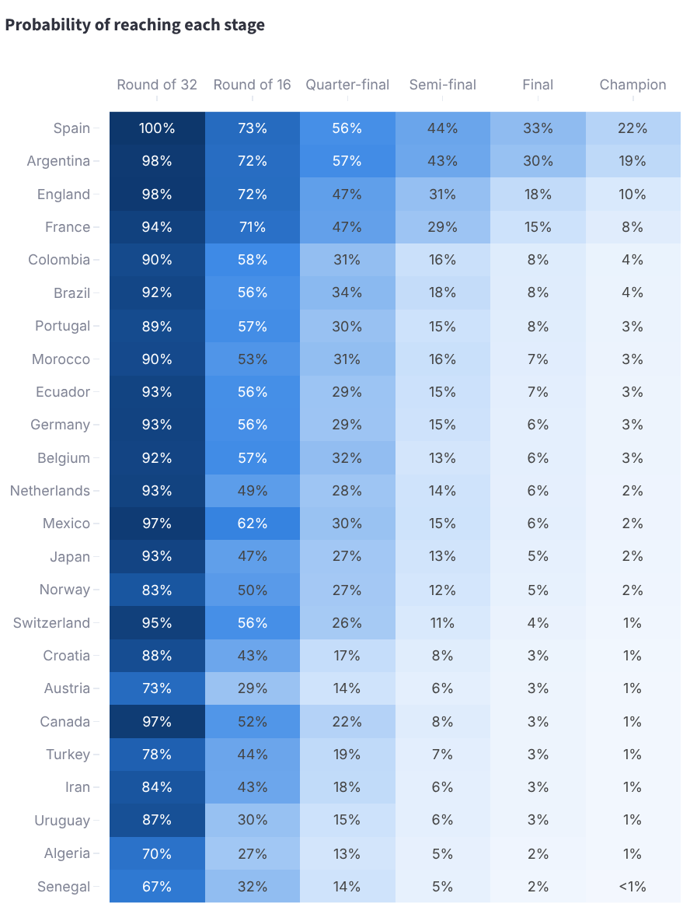
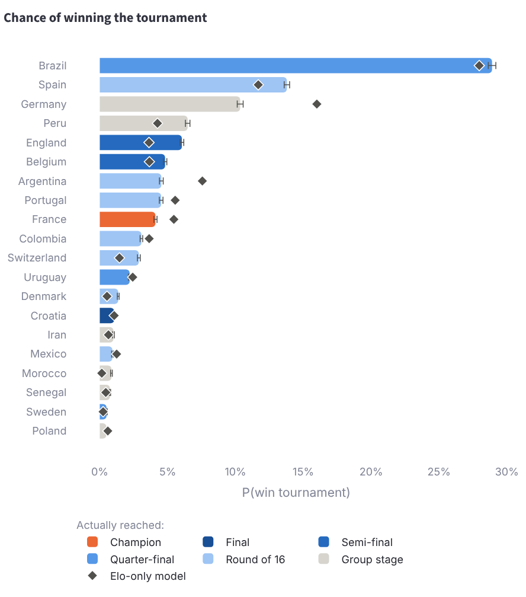
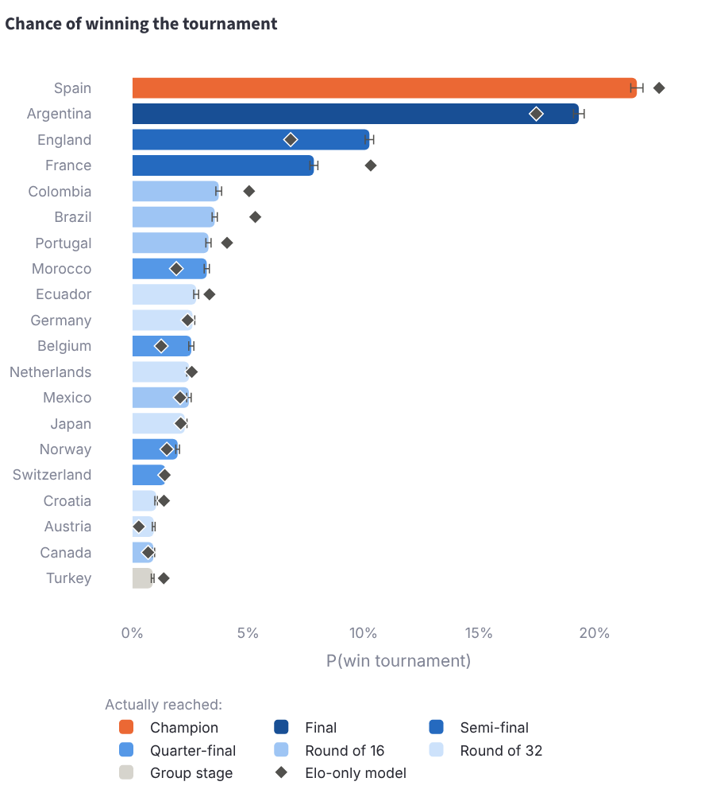
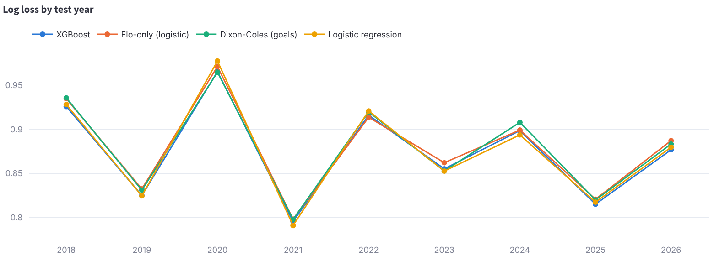
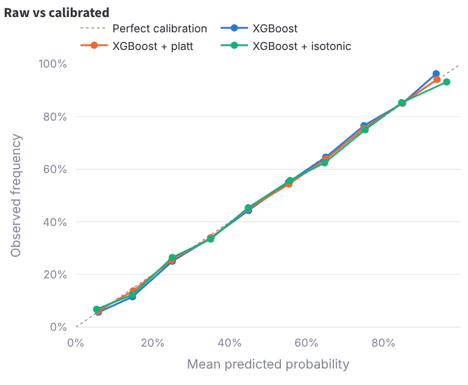
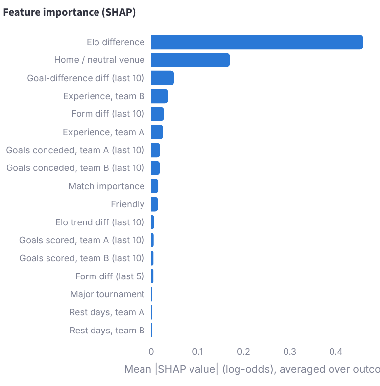
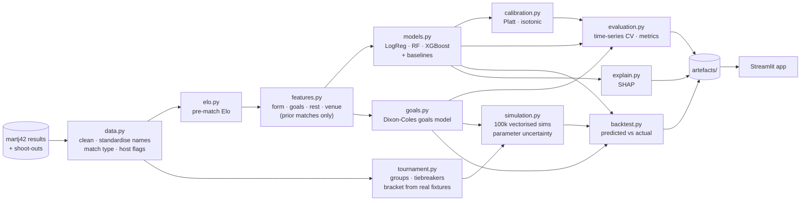

# World Cup Predictor

[](https://github.com/soban0928/portfolio-tracker./actions/workflows/world-cup-predictor.yml)


An international football match-prediction and tournament-simulation engine.
The **2018, 2022 and 2026 FIFA World Cups** are framed as genuine forecasts:
for each one, every model is trained only on matches played before the opening
kick-off, and every team's form and rating are frozen at that date. The
predictions are then scored against what actually happened.

**What's in it**

- Custom Elo ratings.
- Leakage-safe features.
- Logistic regression, Random Forest and XGBoost win/draw/loss classifiers.
- A Dixon-Coles-style goals model for scorelines.
- Probability calibration.
- A vectorised simulator of the real 2026 format (48 teams, 12 groups, best
  third-placed teams, tiebreakers, extra time and penalties), run 100,000 times
  per tournament with parameter uncertainty.
- SHAP explanations.
- A Streamlit dashboard.

> **The short version:** the models are well calibrated and clearly better than
> chance, but **almost all of the skill comes from the Elo rating**. XGBoost beats an
> Elo-only baseline by just 0.005 in log loss, and simply backing the higher-rated
> team is as accurate as any model. The full tournament simulation ranked the
> eventual champion **1st in 2026, 2nd in 2022 and 9th in 2018**.

---

## Contents

- [Results](#results)
- [Key charts](#key-charts)
- [Methodology](#methodology)
- [Assumptions](#assumptions)
- [Limitations](#limitations)
- [Setup and reproduction](#setup-and-reproduction)
- [Project structure](#project-structure)
- [Deploying to Streamlit Community Cloud](#deploying-to-streamlit-community-cloud)
- [Data sources](#data-sources)

## Results

### 1. Match-level, out of sample: models vs baselines

Expanding-window time-series cross-validation. For every year 2018–2026, each model
is trained on all matches from 1994 to the end of the previous year, then tested on
that year's 8,441 matches (6,073 excluding friendlies). Lower is better for every
column except accuracy.

| Model | Accuracy | Log loss | Brier | RPS | Calibration error | Log loss (competitive only) |
|---|---:|---:|---:|---:|---:|---:|
| Base rates (no information) | 47.6% | 1.0733 | 0.6508 | 0.2367 | 0.0628 | 1.0687 |
| **Baseline:** always pick the higher-rated team | 60.4% | ∞ ¹ | 0.7914 | 0.2805 | – | ∞ ¹ |
| **Baseline:** Elo-only (logistic) | 60.3% | 0.8708 | 0.5119 | 0.1699 | 0.0121 | 0.8500 |
| Dixon-Coles Elo-only (goals) | 60.4% | 0.8691 | 0.5110 | 0.1696 | 0.0103 | 0.8480 |
| Logistic regression (all features) | 60.1% | 0.8661 | **0.5089** | 0.1690 | 0.0132 | **0.8434** |
| Random Forest | **60.6%** | 0.8694 | 0.5108 | 0.1695 | 0.0125 | 0.8476 |
| **XGBoost** (best by log loss) | 60.4% | **0.8660** | **0.5089** | **0.1689** | **0.0075** | 0.8447 |
| XGBoost + Platt calibration | 60.4% | 0.8661 | 0.5090 | 0.1690 | 0.0077 | 0.8449 |
| XGBoost + isotonic calibration | 60.2% | 0.8730 | 0.5102 | 0.1694 | 0.0095 | 0.8480 |
| Dixon-Coles (goals, all features) | 59.9% | 0.8708 | 0.5119 | 0.1704 | 0.0095 | 0.8482 |

¹ It never predicts a draw, so any drawn match gets probability 0. It is a baseline
for accuracy only.

**Honest reading**

- **Feature-rich models barely beat Elo.**
  - XGBoost improves on the Elo-only baseline by **0.0048 log loss** (about 0.5%).
  - Logistic regression on all features matches XGBoost.
  - Random Forest is no better than Elo-only.
  - The higher-rated-team rule is as accurate as anything (60.4%).
- **The full goals model is slightly *worse* than its Elo-only version** (0.8708 vs
  0.8691). The recent-form terms don't earn their keep at match level.
- **Calibration doesn't help.** Raw XGBoost is already well calibrated. Platt
  scaling changes nothing, and isotonic regression over-fits its four-year
  calibration window and makes log loss worse.
- **Year-to-year variation dwarfs model differences.** Log loss ranges from 0.79
  (2021) to 0.97 (2020) for every model; see the chart below.

### 2. World Cup matches, predicted before kick-off

Group matches are scored on 90-minute win/draw/loss. Knockout ties are scored on
*who advanced*, because the dataset's knockout scores include extra time. Every
prediction uses the team states frozen at the opening match.

| Group-stage log loss | 2018 (48) | 2022 (48) | 2026 (72) |
|---|---:|---:|---:|
| Base rates | 1.053 | **1.063** | 1.096 |
| Elo-only (logistic) | 0.953 | 1.120 | 0.893 |
| XGBoost | 0.944 | 1.115 | 0.906 |
| Dixon-Coles (goals) – used by the simulator | **0.933** | 1.096 | **0.886** |

| Knockout "who advances" log loss | 2018 (16) | 2022 (16) | 2026 (32) |
|---|---:|---:|---:|
| Coin flip | **0.693** | 0.693 | 0.693 |
| Elo-only (logistic) | 0.709 | 0.567 | 0.481 |
| XGBoost | 0.721 | 0.586 | 0.477 |
| Dixon-Coles (goals) | 0.737 | **0.556** | **0.458** |

Where the models underperformed:

- **2022 group stage: every model was worse than base rates.** Saudi Arabia beat
  Argentina, Japan beat Germany and Spain, and Cameroon beat Brazil. Confident
  favourites were punished.
- **2018 knockouts: every model was worse than a coin flip.** Russia knocked out
  Spain, Croatia beat England, and Germany went out in the group stage.
- 2026 went well for the models.
- These samples are tiny (48–72 group matches, 16–32 knockout ties). A difference
  of a few hundredths is noise, so model rankings shouldn't be read from them.

### 3. Tournament outcomes vs the 100,000-simulation forecasts

| | 2018 | 2022 | 2026 |
|---|---|---|---|
| Pre-tournament favourite | Brazil 28.9% | Brazil 29.0% | **Spain 21.8%** |
| Actual champion (rank by P(win)) | France **#9** (4.1%) | Argentina **#2** (28.1%) | Spain **#1** (21.8%) |
| Actual finalists (rank by P(final)) | France #9, Croatia #14 | Argentina #2, France #4 | Spain #1, Argentina #2 |
| Actual semi-finalists (rank by P(semi)) | #5, #8, #9, #14 | #1, #3, #14, **Morocco #28** | **#1, #2, #3, #4** |
| Exit-stage log score: full model ² | −1.231 | **−1.203** | **−1.176** |
| Exit-stage log score: Elo-only simulation | **−1.229** | −1.216 | −1.222 |
| Exit-stage log score: uniform | −1.343 | −1.343 | −1.532 |

² The mean log-probability the simulation gave to the stage where each team
actually went out. Higher (closer to 0) is better.

- **Both simulations beat the uniform baseline every time.**
- **The full model beats the Elo-only simulation in 2022 and 2026,** and is
  essentially tied in 2018 (−1.231 vs −1.229).
- **Its 2018 forecast was poor at the top.** It rated Peru (#4) and Germany (#3)
  well above France (#9). The Elo-only simulation ranked France #6.
- **The Monte Carlo error is small.** Spain's 2026 P(win) is 21.8% ± 0.27% (95%,
  batch-means standard error ×1.96). Simulation noise is negligible next to model
  error.

## Key charts

| 2026: probability of reaching each stage | 2018: forecast vs what happened |
|---|---|
|  |  |

| 2026: forecast vs what happened | Out-of-sample log loss by year |
|---|---|
|  |  |

| Calibration before/after (first-team win) | SHAP feature importance (XGBoost) |
|---|---|
|  |  |

The SHAP chart says the same thing as the metrics. **Elo difference** (mean |SHAP|
0.46) and **venue** (0.17) dominate. The best of the rest, recent goal difference,
reaches only 0.05, and rest days contribute almost nothing.

## Methodology



### Data

[martj42/international_results](https://github.com/martj42/international_results)
contains 49,945 men's internationals from 1872 to 6 Oct 2026, including all 64 + 64
+ 104 World Cup matches for 2018, 2022 and 2026 and every penalty shoot-out. **No
results were typed in by hand.** Cleaning (`data.py`) does the following:

- Standardises team names, with aliases for the FIFA-ranking file.
- Drops non-FIFA competitions (CONIFA, Island Games and similar).
- Classifies each match:
  - **match type:** friendly, competitive, or tournament (major finals);
  - **competition level:** World Cup, continental final, qualifier, Nations
    League, minor tournament, or friendly.
- Flags neutral venues and host nations.
- Infers each World Cup's stages from the fixture count and chronology, and its
  groups from the fixture graph.
- Validates that the knockout tree is consistent.

### Elo (`elo.py`)

Expected score uses a logistic curve with a 400-point scale and +100 for the host:

    E = 1 / (1 + 10^(-(R_home − R_away + venue·100) / 400))

Each match then updates both ratings by K × G × (W − E):

- **K** depends on match importance: World Cup 60, continental final 50,
  qualifier or Nations League 40, other tournament 30, friendly 20.
- **G** scales the update by goal difference: 1 for a draw or one-goal margin,
  1.5 for two goals, and (11 + |GD|)/8 for three or more.
- **W** is 1, 0.5 or 0 for a win, draw or loss.

Ratings are stored *pre-match*. A small grid over the home advantage and K scale
(tuned on 2010–2013 only) changed log loss by under 0.0005, so the defaults stand.

### Features without leakage (`features.py`)

Each team gets a timeline of its state after every match:

- form over the last 5 and 10 matches;
- goals scored and conceded over the last 10;
- Elo trend;
- rest days;
- experience.

A fixture uses each team's state **after its previous match**. Forecasting a future
fixture uses the last state strictly before the date, so training and inference
share one definition. The tests enforce this in three ways:

- changing a future score leaves every earlier feature unchanged;
- truncating the real dataset at a cut-off leaves all features before it
  identical;
- training-time and inference-time features match exactly for the 2022 final.

A FIFA-ranking feature (ranking published strictly before the match) was tested
and **dropped**: it didn't improve CV log loss, and the free ranking data stops
in Sep 2024.

### Models (`models.py`, `goals.py`)

- **Classifiers.** Multinomial logistic regression, Random Forest and XGBoost
  predict win/draw/loss. Every match is also added with the teams swapped, and
  predictions average both orientations. That makes P(A beats B) independent of
  which team is listed first.
- **Goals model.** Each side's expected goals λ is a Poisson regression on:
  - Elo difference;
  - venue;
  - recent attack and opponent defence;
  - match context.

  It uses an 8-year time-decay half-life, plus the Dixon-Coles correction ρ for
  the low scores 0-0, 1-0, 0-1 and 1-1. Classic per-team attack/defence
  parameters were avoided because many national teams play too rarely to
  estimate them. The fitted coefficients (pre-2026) are sensible: +100 Elo means
  about 16% more goals, hosting adds about 22%, and ρ = −0.046.
- **Baselines.** Base rates, an Elo-only logistic model, an Elo-only goals model,
  and "always pick the higher-rated team".
- **Calibration** (`calibration.py`). Isotonic and Platt calibrators are fitted on
  a held-out, *later* four-year slice of each training window, symmetrically
  across the two win classes.

### Validation (`evaluation.py`)

- **Splits are strictly by time.** Expanding windows train from 1994 to the year
  before the test year; there is never any shuffling.
- **Hyperparameters** were chosen on 2010–2013 folds only.
- **Reported metrics** are on 2018–2026 out-of-fold predictions:
  - accuracy;
  - log loss;
  - multi-class Brier score;
  - ranked probability score (RPS);
  - reliability curves and expected calibration error.

### Tournament simulation (`tournament.py`, `simulation.py`)

- **Formats.**
  - 2018 and 2022: 8 groups of 4, top two advance.
  - 2026: 12 groups of 4, top two plus the **8 best third-placed teams** advance
    to a round of 32.
- **Tiebreakers.**
  - 2026: points, then head-to-head points, goal difference and goals among the
    tied teams, **re-applied to any subset still tied**, then overall goal
    difference and goals.
  - 2018/2022: overall goal difference and goals come *before* head-to-head.
  - Fair play and drawing of lots are replaced by pre-tournament Elo (see
    assumptions).
- **Bracket from the real fixtures.** The computed real group tables tell us which
  group position each knockout participant held. This rebuilds the bracket
  without hard-coding it, and it is validated: the tables reproduce *exactly* the
  teams that reached the knockouts in all three tournaments. For 2026's eight
  winner-v-third slots, a 495-combination assignment reproduces the real
  pairings exactly (see assumptions).
- **Simulation steps.** Each batch of 1,000 tournaments:
  1. Draws one coefficient vector from the goals model's approximate posterior
     N(β, Σ), adding model uncertainty.
  2. Samples full group-stage scorelines from the Dixon-Coles distribution.
  3. Ranks every group with the vectorised tiebreakers.
  4. Routes the best third-placed teams through a bitmask lookup.
  5. Resolves knockout ties with P(win in 90′) + P(draw) × [P(win in extra time)
     + P(draw in extra time) × ½]. Extra time runs at ⅓ of the 90-minute
     scoring rates, and penalties are 50/50.
- **Run size and reproducibility.** 100 batches give 100,000 tournaments in about
  5 seconds, from a single generator with seed 2026.
- **Standard errors.** These are reported two ways: binomial, and batch-means. The
  batch-means one is correct when parameters are re-sampled per batch.
- **Host advantage.** All hosts get it in the group stage; in knockouts, only
  the host of the final does.
- **Sanity tests.**
  - Stage probabilities sum to 32/16/8/4/2/1.
  - Stage probabilities never increase from one round to the next.
  - Stronger teams win more often.
  - With 48 equal teams, each wins with probability 1/48 to within Monte Carlo
    error.

### Explainability (`explain.py`)

SHAP explains the best classifier: TreeExplainer for tree models, LinearExplainer
for logistic regression. It is computed on 1,000 matches from 2018 up to the 2026
World Cup.

## Assumptions

1. **Pre-tournament means frozen.**
   - Each forecast uses ratings and form as of the opening match, with no
     in-tournament updating.
   - Rest days between World Cup matches are set to 4.
   - Every team's form comes from its matches up to the start of the tournament.
2. **Fair play and drawing of lots are replaced by pre-tournament Elo**, because
   the data has no cards. When *rebuilding the real 2018 tables*, Japan and Senegal
   (level on everything but fair play) are separated by who actually advanced.
   That observed tiebreak is never used in simulations.
3. **2026 third-place routing.** FIFA's official 495-row table for which group
   winner faces which third-placed team isn't in the data, and it couldn't be
   downloaded here. The simulator reproduces the real 2026 assignment exactly.
   For other combinations it keeps real pairings where possible and otherwise
   assigns deterministically, never pairing a team with its own group winner.
   Supplying FIFA's table as a CSV would make this exact.
4. **Group numbering.** Groups are numbered by first kick-off, which may not match
   FIFA's letters.
5. **Penalties are 50/50**, and extra time is ⅓ of the 90-minute scoring rate.
6. **Knockout home advantage** applies only to the host of the final (Russia,
   Qatar, United States). All hosts get it in the group stage.
7. **The 2026 results come from the dataset as published.** I have not
   independently verified them.

## Limitations

- **Upsets are the sport.** A 60%-accurate model is near the ceiling for
  international football. Single tournaments (2018 knockouts, the 2022 group
  stage) can make any model look bad.
- **The tournament sample is tiny.** Three World Cups, three champions: champion
  ranks of 1, 2 and 9 can't tell a good model from a lucky one. The 8,441-match
  rolling CV is the more reliable evidence.
- **Draws are hard to predict.** About 22% of matches are drawn, but XGBoost makes a
  draw its single most likely outcome in only 0.15% of matches (2022–2023), and in
  none of the 232 World Cup matches. Draw probabilities mostly sit between 14% and
  30% (median about 25%) and carry little information. Accuracy is therefore
  capped, and models are better judged by log loss and RPS.
- **The complex models add little.** Most of the signal is in Elo. The extra
  features improve log loss by about 0.5%, and the full goals model doesn't beat
  its Elo-only version at match level.
- **Parameter uncertainty is narrow.** It samples coefficient error only, which is
  small with 20k–30k training matches. It doesn't capture model misspecification,
  squad news, injuries, managers or squad age. Real uncertainty is larger than
  the error bars suggest.
- **No player-level data.** Squads, injuries and suspensions are invisible to the
  model.
- **Knockout match metrics** score who advanced rather than 90-minute results,
  because extra-time scores can't be separated in the data.

## Setup and reproduction

Requires Python 3.11 or later. All commands run from `world-cup-predictor/`.

```bash
python -m venv .venv && source .venv/bin/activate
make install          # pip install -e ".[dev]"
make test             # 122 tests, ~35 s, coverage report (98% of src/)
make lint             # ruff check + ruff format --check
make app              # streamlit run app/Home.py
```

The committed `artefacts/` and `data/raw/` snapshot make the dashboard work
immediately. To regenerate everything:

```bash
make data             # re-download raw data (checksums -> data/raw/CHECKSUMS.txt)
make pipeline         # CV, calibration, SHAP, 3 x 100k simulations (~3.5 min, 4 cores)
make quick            # same with 2,000 sims, into artefacts_quick/
```

Reproducibility:

- Seeds are fixed: `SEED = 2026` for models, CV, SHAP and simulations.
- Model artefacts are saved under `artefacts/models/` (per-tournament goals model
  and XGBoost) and `artefacts/current/` (all-data models for the Match
  Predictor).
- Re-downloading the data reproduces the snapshot only while upstream is
  unchanged.

## Project structure

```
world-cup-predictor/
├── src/wcpredict/
│   ├── config.py        seeds, paths, tournament dates
│   ├── data.py          load, clean, classify, World Cup extraction and validation
│   ├── elo.py           Elo ratings
│   ├── features.py      leakage-safe features, inference-time team states
│   ├── models.py        classifiers and baselines
│   ├── goals.py         Dixon-Coles-style goals model
│   ├── calibration.py   Platt and isotonic calibration
│   ├── evaluation.py    metrics, time-series CV, calibration curves
│   ├── tournament.py    formats, tiebreakers, bracket from real fixtures
│   ├── simulation.py    vectorised Monte Carlo
│   ├── pipeline.py      pre-tournament contexts and pair features
│   ├── backtest.py      predicted vs actual
│   ├── explain.py       SHAP
│   └── predict.py       Match Predictor backend
├── app/                 Streamlit UI (only calls into wcpredict)
├── scripts/             download_data.py, run_pipeline.py
├── notebooks/           exploration only
├── data/raw/            committed data snapshot + checksums
├── artefacts/           pipeline outputs used by the app and this README
├── tests/               pytest suite (unit, leakage, tiebreak, simulation, app)
└── Makefile
```

> This project lives in a subfolder of the `portfolio-tracker.` repository. It is
> self-contained and can be split into its own repository with full history:
> `git subtree split --prefix world-cup-predictor`.

## Deploying to Streamlit Community Cloud

1. Push the repository to GitHub.
2. On [share.streamlit.io](https://share.streamlit.io), choose **Create app** and
   select this repo and branch.
3. Set the main file path to `world-cup-predictor/app/Home.py` and choose Python
   3.11 or later.
4. Point *Advanced settings → requirements file* at
   `world-cup-predictor/requirements.txt` (or move it to the repo root).

The app adds `src/` to its import path and reads the committed artefacts, so no
training runs at start-up. If the host's XGBoost version can't unpickle the saved
classifier, the app retrains the current model from the committed data in a few
seconds.

## Data sources

| Data | Source | Licence |
|---|---|---|
| International results 1872–2026 and shoot-outs | [martj42/international_results](https://github.com/martj42/international_results) (also on Kaggle) | CC0 1.0 |
| FIFA men's ranking 1992–2024 (tested, not used) | [Dato-Futbol/fifa-ranking](https://github.com/Dato-Futbol/fifa-ranking) | see repo |

Full details and checksums are in [`data/SOURCES.md`](data/SOURCES.md).
